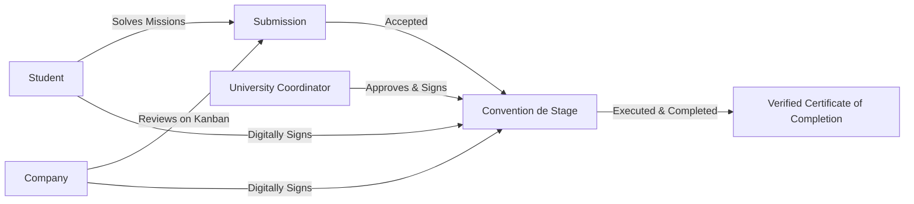

<div align="center">

# 🎓 StageUp

**Tunisia's First Proof-of-Work Internship & Reputation Ledger Platform**  
*Eliminating internship ghosting through verifiable skills, accountability scoring, and legally structured 3-party Conventions de Stage.*

<br/>

[](https://www.ruby-lang.org/)
[](https://rubyonrails.org/)
[](https://www.postgresql.org/)
[](https://hotwired.dev/)
[](#-running-the-test-suite)
[](#-security--data-integrity)
[-EA580C?style=for-the-badge&logo=translate&logoColor=white)](#-internationalization-i18n)

</div>

---

## 📖 Table of Contents

- [Problem Statement & Solution](#-problem-statement--solution)
- [System Roles & Capabilities](#-system-roles--capabilities)
- [Key Features](#-key-features)
  - [1. Proof-of-Work Mission Engine](#1-proof-of-work-mission-engine)
  - [2. Commitment Score & Anti-Ghosting Ledger](#2-commitment-score--anti-ghosting-ledger)
  - [3. Tripartite Convention de Stage & Signature Flow](#3-tripartite-convention-de-stage--signature-flow)
  - [4. Trust Ledger Certificate of Completion & Public QR Verification](#4-trust-ledger-certificate-of-completion--public-qr-verification)
  - [5. 300+ Deep-Dive Industry Skills Catalog](#5-300-deep-dive-industry-skills-catalog)
  - [6. Real-Time Kanban Application Pipeline](#6-real-time-kanban-application-pipeline)
  - [7. Modern Vercel/Linear Aesthetic & Theme Switching](#7-modern-vercellinear-aesthetic--theme-switching)
  - [8. Trilingual Localization (EN / FR / AR RTL)](#8-trilingual-localization-en--fr--ar-rtl)
- [Tech Stack](#-tech-stack)
- [Getting Started](#-getting-started)
  - [Option A — Docker Setup (Recommended)](#option-a--docker-setup-recommended)
  - [Option B — Local Native Setup](#option-b--local-native-setup)
- [Pre-Seeded Demo Accounts](#-pre-seeded-demo-accounts)
- [Environment Variables](#-environment-variables)
- [Running the Test Suite](#-running-the-test-suite)
- [Background Processing](#-background-processing)
- [Project Architecture](#-project-architecture)
- [Security & Data Integrity](#-security--data-integrity)
- [Deployment](#-deployment)
- [License](#-license)

---

## 🎯 Problem Statement & Solution

In the emerging North African tech and engineering ecosystem, **internship ghosting** creates severe friction:
- **Companies** post offers and often leave applicants hanging for weeks without a response.
- **Students** accept offers and abandon internships without notice or submit unverifiable resumes.
- **Universities** struggle to monitor agreement status, accreditation compliance, and completion validity.

### The StageUp Fix
1. **Proof-of-Work First**: Candidates prove hands-on proficiency via timed GitHub/code/design challenges before applications are evaluated.
2. **Transparent Accountability**: Every action (on-time responses, evaluations, completions, abandonments) is logged to a permanent **Commitment Score** audit trail.
3. **Seamless Legal Compliance**: Accepted applicants generate an official, legally structured *Convention de Stage* requiring digital signatures from the student, company supervisor, and university coordinator.
4. **Cryptographic Trust Verification**: Fully executed internships award an authentic gold-framed **Certificate of Completion** backed by a unique ledger verification token and scannable QR code.

---

## 👥 System Roles & Capabilities



| Role | Core Capabilities |
|------|-------------------|
| **🎓 Student** | • Search & filter verified offers by skill, type (PFE, PFA, Initiation), & location<br/>• Submit timed proof-of-work solutions with automated repo checks<br/>• Track application status via visual Kanban progress tracker<br/>• Digitally sign *Convention de Stage* & access official Certificate of Completion |
| **🏢 Company** | • Publish internship offers with attached coding, design, or data missions<br/>• Real-time application triage via drag-and-drop Kanban pipeline<br/>• Score candidate submissions, review GitHub repos, and evaluate milestones<br/>• Digitally sign agreements & maintain a verified company badge |
| **🏛️ University Coordinator** | • Enforce institutional oversight across enrolled students<br/>• Review company validity & approve/sign *Conventions de Stage*<br/>• Direct student validation gate to prevent fraudulent submissions |
| **🛡️ Master Admin** | • Approve institutional coordinators & verify company domain registrations<br/>• Audit user commitment logs, resolve state machine disputes, & manage platform health |

---

## ✨ Key Features

### 1. Proof-of-Work Mission Engine
- Companies can attach targeted missions (coding problems, system designs, telemetry datasets) to listings.
- Applicants accept a **48-hour countdown timer** to submit their proof repository or design files.
- Automated background worker (`VerifySubmissionJob`) verifies repository accessibility, file limits, and code structure.

### 2. Commitment Score & Anti-Ghosting Ledger
Every user profile starts with a baseline **100/100** score:
- ⏱️ **+1 pt**: Company evaluates an applicant on time (< 14 days).
- ⚠️ **-5 pts**: Company responds late (14+ days).
- 🚨 **-15 pts**: Company ghosts an application (scheduled sweep via `ReputationTrackerJob`).
- 🏆 **+15 pts**: Student successfully completes an accredited internship.
- ❌ **-25 pts**: Student abandons an active agreement without cause.
- ⌛ **-10 pts**: Repeated expiration of accepted proof-of-work missions.

### 3. Tripartite Convention de Stage & Signature Flow
- Automatically generates a 3-party contract complete with internship duration, legal obligations, academic supervisor, and compensation details.
- Real-time signatory progress stepper (`Student` → `Company` → `University Coordinator`).
- Concurrency-safe state machine protected by PostgreSQL row locks (`with_lock`).

### 4. Trust Ledger Certificate of Completion & Public QR Verification
- Awarded when an agreement is `fully_executed` and verified.
- **A4 Landscape Luxury Diploma Design**: Gold double-border, star ornament, gold rosette seal, and university accreditation badges.
- **Embedded QR Code**: Scannable public verification token linking to `/certificates/verify/:token`.
- **Zero Dark-Mode Collapse in Print**: Theme-isolated layout with `@media print` rules for PDF generation.

### 5. 300+ Deep-Dive Industry Skills Catalog
Organized into 15 technical and business verticals:
- **Backend & Distributed Systems**: Ruby on Rails, Go, Django, Node.js, Spring Boot, PostgreSQL, Redis, Kafka
- **Frontend & Web Core**: React, Next.js, Vue, TypeScript, Tailwind CSS, WebAssembly, Svelte
- **AI, ML & Data Science**: PyTorch, TensorFlow, LLMs, RAG Architectures, Computer Vision, MLOps
- **DevOps, Cloud & SRE**: Docker, Kubernetes, Terraform, AWS, CI/CD Pipelines, Prometheus
- **UI/UX & Product Design**: Figma, Design Systems, Motion Graphics, User Research
- **Hardware & Engineering**: Embedded C/C++, STM32, PCB Design, SolidWorks, CATIA, FEA Analysis

### 6. Real-Time Kanban Application Pipeline
- Drag-and-drop / column-based application status: `Submitted` ➔ `In Review` ➔ `Accepted` ➔ `Signed` ➔ `Completed`.
- Live updates via Hotwire Turbo Streams and Solid Cable.

### 7. Modern Vercel/Linear Aesthetic & Theme Switching
- High-contrast **Dark Mode** default with semantic CSS token architecture.
- Seamless toggle to **Light Mode** without visual contrast collapse.
- Mobile-responsive navigation drawer with touch-friendly 44px targets.

### 8. Trilingual Localization (EN / FR / AR RTL)
- Native support for **English**, **French (Français)**, and **Arabic (العربية)**.
- Dynamic `dir="rtl"` layout switching for Arabic with localized typography.

---

## 🛠️ Tech Stack

```
Frontend:       Hotwire (Turbo 8 + Stimulus), Vanilla Semantic CSS, Lucide Icons
Backend:        Ruby on Rails 8.1.3, Ruby 3.3.11
Database:       PostgreSQL 16 (pg_trgm Fuzzy Search + GIN Indexing)
Jobs & Cache:   Solid Queue, Solid Cache, Solid Cable (Rails 8 Defaults)
Auth & Access:  Devise (Lockable, Timeoutable, Trackable), Rack::Attack
Storage:        Active Storage (Local / AWS S3)
QR & PDF:       RQRCode, SVG Vector Rendering, Print CSS Engine
Deployment:     Docker Compose, Kamal, Vercel Serverless
```

---

## 🚀 Getting Started

### Option A — Docker Setup (Recommended)

```bash
# 1. Clone repository
git clone https://github.com/wacim-abdellli/stageup.git
cd stageup

# 2. Copy environment file
cp .env.example .env

# 3. Spin up PostgreSQL & Web containers
docker compose up -d

# 4. Prepare database & seed skills/demo accounts
docker compose exec web bin/rails db:prepare db:seed
```
Visit **http://localhost:3000** in your browser.

---

### Option B — Local Native Setup

**Prerequisites:** Ruby 3.3.x, PostgreSQL 16, Bundler

```bash
# 1. Clone repository & install dependencies
git clone https://github.com/wacim-abdellli/stageup.git
cd stageup
bundle install

# 2. Configure environment
cp .env.example .env

# 3. Start PostgreSQL service, create database & seed records
bin/rails db:create db:migrate db:seed

# 4. Start Puma development server
bin/rails server -p 3000
```
Visit **http://localhost:3000** in your browser.

---

## 🔑 Pre-Seeded Demo Accounts

All test accounts share the default password: **`password123456`**

| Role | Email | Profile / Context |
|------|-------|-------------------|
| **🛡️ Master Admin** | `wacimabdelli01@gmail.com` | Full Administrative Platform Control |
| **🎓 Student (100 pts)** | `mohamed.benali@isetsf.rnu.tn` | Mohamed Ben Ali · Software Engineering (ISET Sfax) |
| **🎓 Student (Verified Cert)** | `cyrine.trabelsi@enis.tn` | Cyrine Trabelsi · Data Science & AI (ENIS) |
| **🎓 Student (IoT)** | `youssef.chaabane@isetsf.rnu.tn` | Youssef Chaabane · Embedded Systems (ISET Sfax) |
| **🏢 Company (Verified)** | `contact@devcorp.tn` | DevCorp Sfax · Software Agency |
| **🏢 Company (Tech/AI)** | `recruiting@alphatech.co` | AlphaTech Startups · AI & IoT |
| **🏛️ Coordinator (ISET)** | `ahmed.mansour@isetsf.rnu.tn` | Prof. Ahmed Mansour · IT Department |
| **🏛️ Coordinator (ENIS)** | `leila.siala@enis.tn` | Prof. Leila Siala · Computer Science Dept |

> 💡 **Direct Certificate Verification Demo**:  
> Navigate to **`http://localhost:3000/certificates/verify/9BV0bQXrNWsGjUmEJHOBuw`** to inspect the verified certificate issued to Cyrine Trabelsi.

---

## ⚙️ Environment Variables

| Variable | Description | Default / Example |
|----------|-------------|-------------------|
| `POSTGRES_HOST` | Database host | `127.0.0.1` (`db` in Docker) |
| `POSTGRES_PORT` | Database port | `5439` (Docker host port) / `5432` |
| `POSTGRES_USER` | PostgreSQL username | `postgres` |
| `POSTGRES_PASSWORD` | PostgreSQL password | `postgres` |
| `DEV_DB_NAME` | Development database name | `stageup_development` |
| `TEST_DB_NAME` | Test database name | `stageup_test` |
| `DATABASE_URL` | Production database connection string | `postgresql://...` |
| `APP_HOST` | Primary domain hostname | `stageup.tn` |
| `RAILS_MASTER_KEY` | Master key for encrypted credentials | `[Secret Key]` |

---

## 🧪 Running the Test Suite

The test suite enforces 100% test integrity with comprehensive unit, integration, and security tests:

```bash
# Run the entire test suite
bin/rails test

# Run a specific controller test
bin/rails test test/controllers/certificates_controller_test.rb

# Run a specific model validation test
bin/rails test test/models/internship_agreement_test.rb
```

---

## 🔄 Background Processing

Scheduled tasks are managed via **Solid Queue** and configured in `config/recurring.yml`:

| Job Name | Schedule | Purpose |
|----------|----------|---------|
| `ReputationTrackerJob` | Daily at Midnight (`0 0 * * *`) | Detects ghosted submissions (>14 days) and deducts company reputation points |
| `ResolveExpiredSubmissionsJob` | Hourly (`0 * * * *`) | Automatically expires uncompleted proof-of-work missions (>48h) |

Start background worker manually in development:
```bash
bin/rails solid_queue:start
```

---

## 🏗️ Project Architecture

```
stageup/
├── app/
│   ├── controllers/
│   │   ├── admin/                # Verification, Coordinator approval, System audit
│   │   ├── certificates_controller.rb   # Dedicated certificate verify endpoint
│   │   ├── dashboards_controller.rb     # Role-aware dashboard & milestone tracker
│   │   ├── internship_agreements_controller.rb # 3-party contract & signing flow
│   │   ├── offers_controller.rb         # Offer postings & skill match calculations
│   │   └── submissions_controller.rb    # Proof-of-work application lifecycle
│   ├── models/
│   │   ├── commitment_event.rb   # Immutable reputation audit ledger
│   │   ├── company_profile.rb    # Company metrics & response tracking
│   │   ├── internship_agreement.rb # Legally structured contract state machine
│   │   ├── student_profile.rb    # Student portfolio & commitment score
│   │   └── user.rb               # Devise auth & polymorphic profileable association
│   ├── views/
│   │   ├── certificates/         # Verified Diploma view & A4 landscape print CSS
│   │   ├── layouts/
│   │   │   ├── application.html.erb # Main app layout with dark/light mode
│   │   │   └── certificate.html.erb # Standalone theme-isolated certificate layout
│   └── jobs/                     # Solid Queue asynchronous worker jobs
├── config/
│   ├── initializers/
│   │   ├── content_security_policy.rb # Strict CSP nonce configuration
│   │   └── rack_attack.rb             # Rate-limiting & auth attack mitigation
│   └── recurring.yml             # Solid Queue cron schedules
└── db/
    ├── migrate/                  # PostgreSQL migrations with GIN & foreign keys
    └── seeds.rb                  # Seeder for 300+ skills & demo institutions
```

---

## 🔒 Security & Data Integrity

- **Strict Content Security Policy (CSP)**: Nonce-based execution across all inline scripts and styles (`style-src :self`, `script-src :self`, `nonce_directives`).
- **Row-Locking Concurrency**: All commitment score changes, status machine transitions, and signature registrations use explicit PostgreSQL row locks (`with_lock`) inside transactions.
- **IDOR Protection**: Strict scoping to authenticated user profiles (`current_user.profileable`).
- **Authentication Hardening**: 12-character minimum passwords, account lockouts after 10 failed attempts, and rate-limiting via `Rack::Attack`.

---

## 🚢 Deployment

### Kamal (Containerized Production)
```bash
# Deploy latest release
kamal deploy

# Run remote database migrations
kamal app exec 'bin/rails db:migrate'
```

### Vercel Serverless
Configured with `@vercel/ruby` via `vercel.json` and custom Rack asset handling in `config.ru`.

---

## 📄 License

Proprietary software. All rights reserved.  
Built with ❤️ for Tunisian universities, students, and startups.
